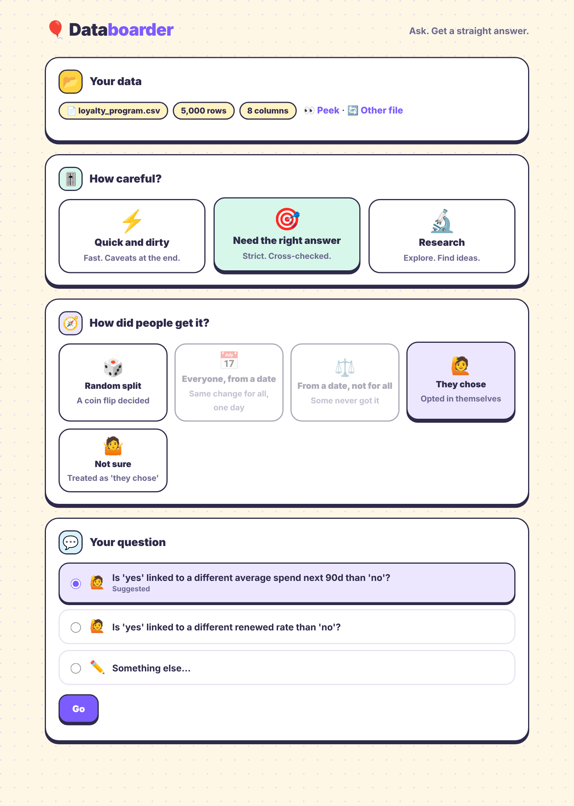
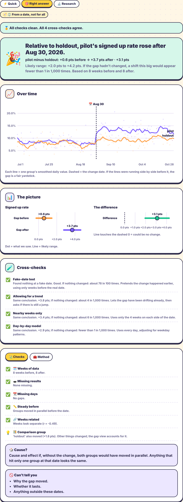
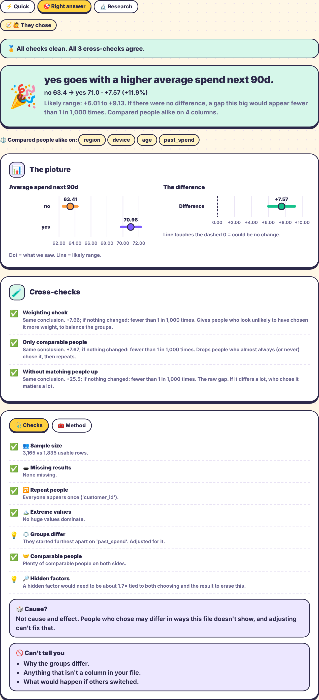
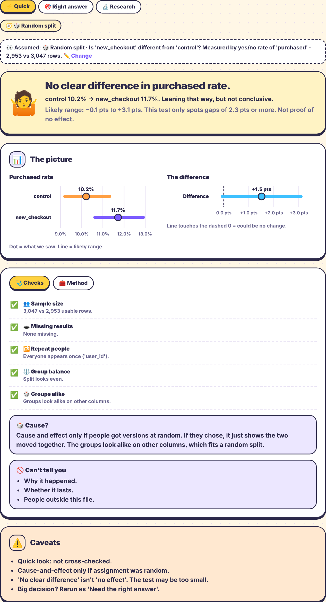

# Databoarder

**Reusable analysis that anyone can check and re-run.**

Ask a business question, upload a CSV, and get a plain-language answer with the checks behind it. Every report comes with a script that reproduces each number from the raw file. Covers A/B tests, before/after changes (with or without a comparison group), and comparisons where people chose for themselves.

## How it works, step by step
1. **Add the data you want to analyze.** A CSV with one row per person, order or day. The app tidies obvious formatting problems and lists exactly what it changed.
2. **How careful do you need to be?** The method is the same every time. Higher levels add more double-checks.
3. **How did people end up with the change?** Random split, everyone from a date, some never got it, or they chose. This decides which comparison is fair and how strongly the answer can be worded.
4. **What do you want to know?** Pick a ready-made question built from your own columns, or type one.
5. **Check we understood you.** A sentence written by the program (not the AI) says what will be compared. Fix anything that's off before anything runs.
6. **Here's your answer.** What was found, how sure we are, and what can't be told from this data.
7. **Check it, or run it yourself.** Every check, a plain-words explanation of each number, and a script that reproduces the numbers from the raw file.

**What the AI does and doesn't do:** it only turns a typed question into the form in step 5, seeing column names, types and up to six example values per column. All statistics come from fixed, tested code.

## Screenshots
(Synthetic sample data with planted answers; see `sample_data/` and `tools/`.)

**Set-up: the "How did people get it?" step picks the method**

**Comparison group (difference-in-differences), "Right answer" mode with cross-checks**

**People chose: adjusted comparison, worded as "goes with", with a hidden-factor note**

**A/B test, "Quick" mode**

## Run
    python -m pip install -r requirements-dev.txt   # requirements.txt is enough to just run it
    export ANTHROPIC_API_KEY=...   # optional; without it, columns are guessed from names
    python -m uvicorn app.main:app   # then open http://localhost:8000
    python -m pytest

## Design
- The LLM only translates a question into an `ABTestSpec` (app/translator.py). It never computes.
- Statistics are fixed, tested code (app/ab_test.py, app/modes.py); data checks run first (app/checks.py).
- The read-back sentence is written by code from the spec, so the user confirms what will actually run.
- Three kinds of work: **Quick and dirty** (caveats at the end), **Need the right answer** (independent
  cross-checks, shaky things flagged up top), **Research** (subgroup scan with Holm correction).

## Method tabs (app/knowledge.py is the single source of truth)
- **Assumptions** per method, each marked checked (data looked fine), concern, or "you confirm".
- **Technical**: textbook-correct definition of every number.
- **In practice**: what each number means, in plain words.
- **Reproduce**: data fingerprint (sha256), library versions, seed, code per number, and a standalone script
  that reproduces every number in the report (including cross-checks and slices).

## Correctness and reproducibility guards (tests/)
- Newcombe range and pooled z-test re-derived by hand; Welch range and detectable gap re-derived by hand.
- Simulations: the 95% range covers the truth about 95% of the time; false alarms stay near 5%.
- The generated script is executed in every mode and its output compared with the report.
- Same data in, identical report out (fixed seed).

## Analyses
- **A/B test** (`app/ab_test.py`): two groups shown different versions at the same time.
- **Before/after** (`app/before_after.py`): did a number change after a date? You supply the date; it is never searched for.
  Whole 7-day weeks are counted outward from the date and compared with Welch's t-test, so weekday swings cancel and
  linked neighbouring days don't fake precision (simulated coverage ~95%). Cross-checks: fake date, allowing for a trend,
  nearby weeks only, day-by-day model. Research mode scans slices. Sample: `sample_data/signup_page_change.csv`
  (made by `tools/make_signup_sample.py`; planted truth is in its docstring).

## "How did people get it?" (app/design.py)
An up-front question picks the method **and** the wording of the verdict:
🎲 random split → A/B test (plus a "Groups alike" balance check) · 📅 everyone from a date → before/after ·
⚖️ from a date, some never got it → before/after **with a comparison group** (difference-in-differences) ·
🙋 they chose / 🤷 not sure → **adjusted comparison** (worded "goes with", never "raised"; includes a hidden-factor / E-value note).
Quick mode preselects a best guess and shows it in the "Assumed:" strip; the other modes require a tap.
Cutoff-style designs are not covered yet.

Samples with planted truths: `regional_rollout.csv` (true extra effect +2.4 pts) and `loyalty_program.csv` (true effect +$5; raw gap is far larger).
Tests: `tests/test_designs.py`.

## Data preparation (app/prep.py)
On upload the file is checked and only unambiguous fixes are applied: trimmed spaces, "$1,200" → numbers, yes/no outcomes → 1/0, empty columns dropped.
Anything that changes meaning (exact duplicate rows, one-column-per-date layouts) is flagged, not changed.
Each fix is a plain line of code that is also placed at the top of the downloadable script, which starts from the raw CSV. Tests: `tests/test_prep.py`.

## Deploying a demo (Render)
1. Push the repo to GitHub (done), then on render.com choose **New → Blueprint** and pick this repo. It reads `render.yaml` and the `Dockerfile`.
2. When asked, set two environment variables (they are never stored in the repo):
   - `ANTHROPIC_API_KEY`: your key. Without it the app still works but guesses columns from names.
   - `APP_PASSWORD`: one shared password for the whole site (browser sign-in box; the username can be anything).
3. Open the URL Render gives you. `/healthz` is the only page without the password.

Notes
- **Single instance.** Uploaded files live in memory (the newest 40 are kept), so don't scale to several instances. The free plan sleeps and forgets uploads; use a paid plan for demos.
- **Set a spend limit** in the Anthropic Console. The password is what stops strangers using your key.
- Uploaded CSVs sit on the host's server. Don't use sensitive data in a public demo.
- The same image runs anywhere Docker does: `docker build -t databoarder . && docker run -p 8000:8000 -e APP_PASSWORD=pw databoarder`.
- Choosing the model: set `DASHBOARDER_MODEL` to override the default.
