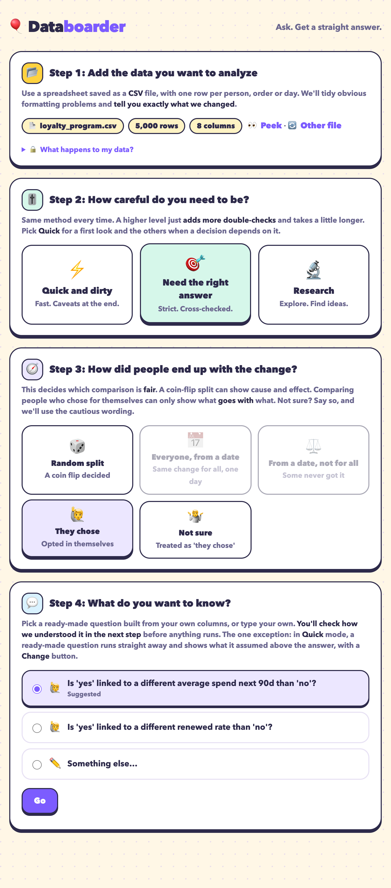
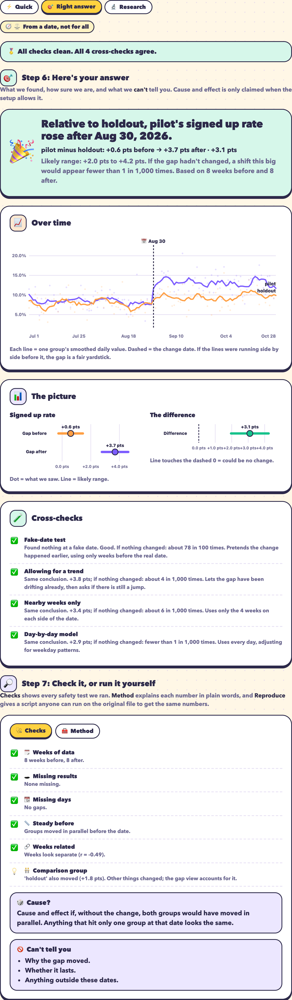
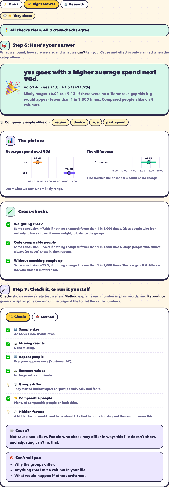
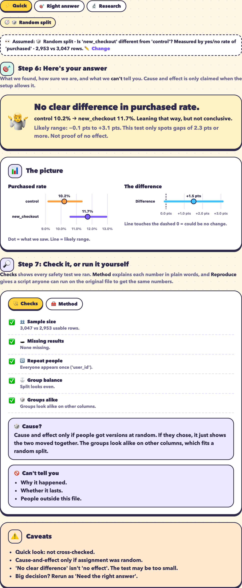

# Databoarder

**Reusable analysis that anyone can check and re-run.**

Ask a business question, upload a CSV, and get a plain-language answer with the checks behind it. Every report comes with a script that reproduces each number from the raw file. Covers A/B tests, before/after changes (with or without a comparison group), and comparisons where people chose for themselves.

## How it works, step by step
1. **Add the data you want to analyze.** A CSV with one row per person, order or day. The app tidies obvious formatting problems and lists exactly what it changed. If you have several files or a messy Excel export, use **Put them together first** (see [Putting files together](#putting-files-together-appcombinepy)): add everything your analyst sent, check a few numbers about the finished table, and answer the few choices that change the answer. Nothing is used until you've confirmed them.
2. **How careful do you need to be?** The method is the same every time. Higher levels add more double-checks.
3. **How did people end up with the change?** Random split, everyone from a date, some never got it, or they chose. This decides which comparison is fair and how strongly the answer can be worded.
4. **What do you want to know?** Pick a ready-made question built from your own columns, or type one.
5. **Check we understood you.** A sentence written by the program (not the AI) says what will be compared. Fix anything that's off before anything runs. Exception: in Quick mode, a ready-made question runs straight away and shows this sentence as "Assumed" above the answer, with a Change button. Typed questions are always confirmed first.
6. **Here's your answer.** What was found, how sure we are, and what can't be told from this data.
7. **Check it, or run it yourself.** Every check, a plain-words explanation of each number, and a script that reproduces the numbers from the raw file.

**What the AI does and doesn't do:** it turns a typed question into the form in step 5 and, in the step-by-step file builder, suggests steps if you ask. On the one-screen combine flow, the suggested answers come from fixed code. It sees column names, types, row counts and up to six example values per column, with IDs, emails and phone numbers masked to show only their format. It never sees your rows, and suggested steps do nothing until you confirm them. All statistics come from fixed, tested code.

## Screenshots
(Synthetic sample data with planted answers; see `sample_data/` and `tools/`.)

**Set-up: the "How did people get it?" step picks the method**

**Comparison group (difference-in-differences), "Right answer" mode with cross-checks**

**People chose: adjusted comparison, worded as "goes with", with a hidden-factor note**

**A/B test, "Quick" mode**

## Run
Python 3.12 (the version the `Dockerfile` uses).

    python3.12 -m venv .venv
    .venv/bin/pip install -r requirements-dev.txt     # requirements.txt is enough to just run it
    .venv/bin/python -m playwright install chromium   # once, for the browser tests; without it they're skipped
    export ANTHROPIC_API_KEY=...   # optional; without it, columns are guessed from names
    .venv/bin/python -m uvicorn app.main:app --reload   # then open http://localhost:8000
    .venv/bin/python -m pytest

`local_data/` isn't in git. It holds the fake messy analyst pull built from the Hillstrom email test
(`local_data/hillstrom/`, see its `ABOUT.md`). Copy it over, or rebuild it with `tools/make_messy_hillstrom.py` from
the public Hillstrom CSV. Tests that need it are skipped without it.

Real-model checks, which call the API and cost money: `python -m evals.translator_cases` (typed questions become the
right form) and `python -m evals.recipe_cases` (AI-suggested steps rebuild the right table; needs `local_data/`).

## Design
- The LLM only translates a question into one of four fixed forms (`ABTestSpec`, `BeforeAfterSpec`, `DiDSpec`,
  `ObservationalSpec` in app/schemas.py), via app/translator.py. It never computes. If its answer doesn't fit the
  data, columns are guessed by code instead and a note says so.
- Choices the person made while putting the table together (who got the campaign, or the date) carry into the
  question screens. If the AI picks a different column, the confirmed one is used and a note says why.
- Statistics are fixed, tested code (app/ab_test.py, app/modes.py); data checks run first (app/checks.py).
- The read-back sentence is written by code from the spec, so the user confirms what will actually run.
- Three kinds of work: **Quick and dirty** (caveats at the end), **Need the right answer** (independent
  cross-checks, shaky things flagged up top), **Research** (subgroup scan with Holm correction).

## Method tabs (app/knowledge.py is the single source of truth)
- **Assumptions** per method, each marked checked (data looked fine), concern, or "you confirm".
- **Technical**: textbook-correct definition of every number.
- **In practice**: what each number means, in plain words.
- **Reproduce**: data fingerprint (sha256), library versions, seed, code per number, and a standalone script
  that reproduces every number in the report (including cross-checks and slices).

## Correctness and reproducibility guards (tests/)
- Newcombe range and pooled z-test re-derived by hand; Welch range and detectable gap re-derived by hand.
- Simulations: the 95% range covers the truth about 95% of the time; false alarms stay near 5%.
- The generated script is executed in every mode and its output compared with the report.
- Same data in, identical report out (fixed seed).
- The downloadable script stops if the original files or the rebuilt table don't match what the report used.
- Browser tests (Playwright, `tests/browser/`) drive the combine screen end to end.

## Analyses
- **A/B test** (`app/ab_test.py`): two groups shown different versions at the same time.
- **Before/after** (`app/before_after.py`): did a number change after a date? You supply the date; it is never searched for.
  Whole 7-day weeks are counted outward from the date and compared with Welch's t-test, so weekday swings cancel and
  linked neighbouring days don't fake precision (simulated coverage ~95%). Cross-checks: fake date, allowing for a trend,
  nearby weeks only, day-by-day model. Research mode scans slices. Sample: `sample_data/signup_page_change.csv`
  (made by `tools/make_signup_sample.py`; planted truth is in its docstring).
- **Before/after with a comparison group** (`app/did.py`): difference-in-differences, for when some groups never got
  the change.
- **Adjusted comparison** (`app/observational.py`): for when people chose for themselves. Compares people who look
  alike on background columns, and is worded "goes with", never "caused".

## "How did people get it?" (app/design.py)
An up-front question picks the method **and** the wording of the verdict:
🎲 random split → A/B test (plus a "Groups alike" balance check) · 📅 everyone from a date → before/after ·
⚖️ from a date, some never got it → before/after **with a comparison group** (difference-in-differences) ·
🙋 they chose / 🤷 not sure → **adjusted comparison** (worded "goes with", never "raised"; includes a hidden-factor / E-value note).
Quick mode preselects a best guess and shows it in the "Assumed:" strip; the other modes require a tap.
Cutoff-style designs are not covered yet.

Samples with planted truths: `regional_rollout.csv` (true extra effect +2.4 pts) and `loyalty_program.csv` (true effect +$5; raw gap is far larger).
Tests: `tests/test_designs.py`.

## Data preparation (app/prep.py)
On upload the file is checked and only unambiguous fixes are applied: trimmed spaces, "$1,200" → numbers, yes/no outcomes → 1/0, empty columns dropped.
Anything that changes meaning (exact duplicate rows, one-column-per-date layouts) is flagged, not changed.
Each fix is a plain line of code that is also placed at the top of the downloadable script, which starts from the raw CSV. Tests: `tests/test_prep.py`.

## Putting files together (app/combine.py)
For the messy files an analyst actually sends: several CSVs and Excel exports, with title rows, IDs written
differently in each file, and one row per order instead of per person.
1. **Add every file at once,** with an optional "What do you want to find out?", which steers the suggestions and
   carries into the question screen.
2. **Check the finished table** against a few numbers (how many people, how many got the campaign, and so on) and a
   peek at its rows.
3. **Answer the few choices that change the answer:** who belongs in the table, who got the campaign, which results
   count and over what window, and what being missing from an activity file means. Each starts as a suggestion and
   is marked as yours once confirmed. **Confirm all suggestions** is there too, below the choices.
4. **Mechanical fixes are listed, collapsed,** with row counts: skipped title rows, matched ID formats, orders added
   up. Matching IDs is done by code, not the AI.

When the files can't answer the question (for example, everyone got the campaign, or IDs look like they'd merge
different people), the table is blocked and the page drafts **a note for your analyst** saying what's missing.
The answers compile into the same recorded recipe the downloadable script runs, so the table can be rebuilt from
the original files. **Build it step by step instead** opens the older builder, for files that don't fit these
choices. Plan: [docs/plans/combine-flow.md](docs/plans/combine-flow.md).

## Deploying a demo (Render)
1. Push the repo to GitHub (done), then on render.com choose **New → Blueprint** and pick this repo. It reads `render.yaml` and the `Dockerfile`.
2. When asked, set two environment variables (they are never stored in the repo):
   - `ANTHROPIC_API_KEY`: your key. Without it the app still works but guesses columns from names.
   - `APP_PASSWORD`: one shared password for the whole site (browser sign-in box; the username can be anything).
3. Open the URL Render gives you. `/healthz` is the only page without the password.

Notes
- **Single instance.** Uploaded files live in memory (the newest 40 are kept), so don't scale to several instances. The free plan sleeps and forgets uploads; use a paid plan for demos.
- **Set a spend limit** in the Anthropic Console. The password is what stops strangers using your key.
- Uploaded CSVs sit on the host's server, and files put together are kept in a temporary folder on its disk for up to 6 hours. Don't use sensitive data in a public demo.
- The same image runs anywhere Docker does: `docker build -t databoarder . && docker run -p 8000:8000 -e APP_PASSWORD=pw databoarder`.
- Choosing the model: set `DASHBOARDER_MODEL` to override the default.
